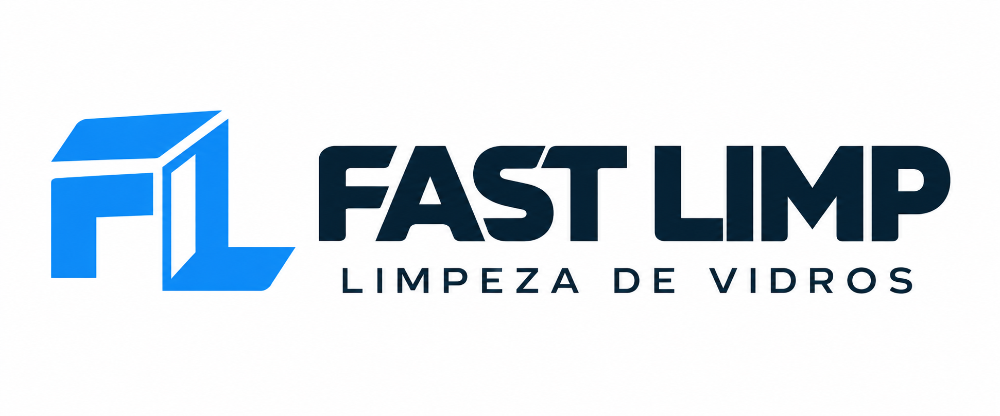
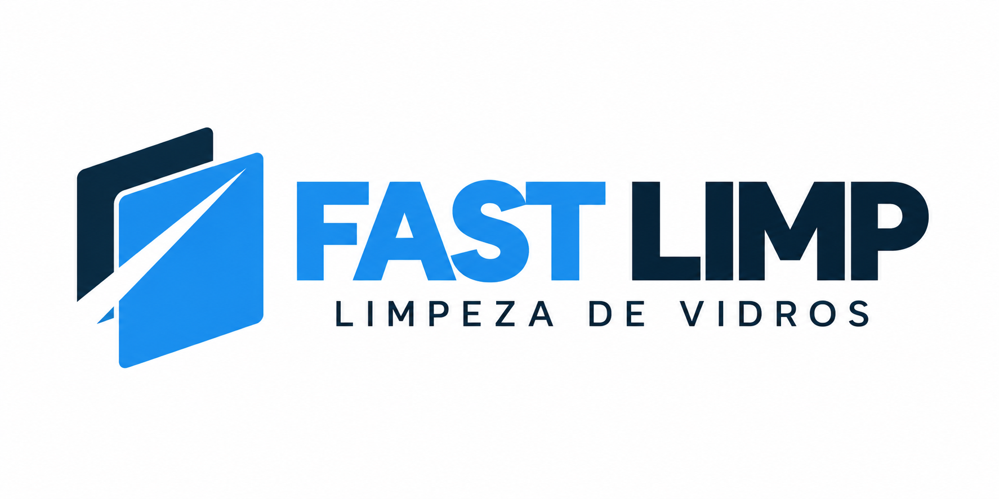
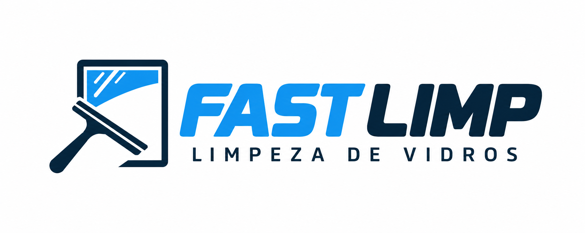
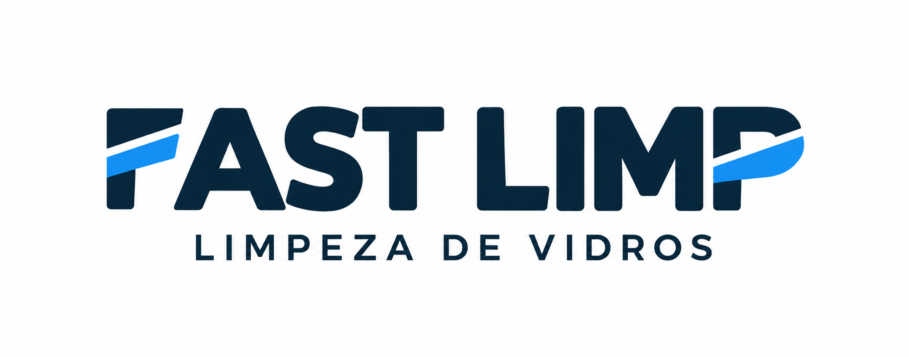
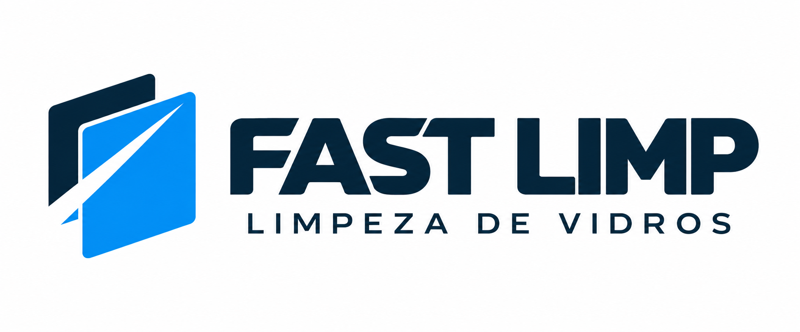

# Fast Limp — manual preliminar de identidade

> Documento histórico de exploração, superado pela escolha do cliente em 14/10/2026: símbolo com rodo do estudo 03 + texto do estudo 01. A entrega atual para validação está em [brandbook-v1/LEIA-ME.md](brandbook-v1/LEIA-ME.md) e no [brandbook PDF](../output/pdf/fast-limp-brandbook-v1-validacao.pdf). Não usar os estudos abaixo como arquivos finais.

Versão 0.3 · 14 de outubro de 2026 · Direções para avaliação

Este documento organiza a base da marca antes do site. A paleta vem do briefing fornecido; o público residencial e empresarial, com equilíbrio, foi confirmado nesta conversa. Logos e demais decisões propostas ainda dependem de escolha e refinamento. As imagens desta rodada são estudos raster gerados com IA, não arquivos vetoriais finais.

## 1. Direção da marca

**Nome:** Fast Limp.

**Descritor proposto:** Limpeza de vidros.

**Posicionamento proposto:** especialista em limpeza de vidros para residências e empresas, com uma apresentação clara, cuidadosa e profissional.

**Ideia central:** precisão que deixa a transparência aparecer.

Essa ideia orienta o desenho; não é um slogan aprovado. O nome já comunica agilidade. O símbolo deve acrescentar especialização e cuidado, sem depender de vários sinais de velocidade.

**Personalidade:** precisa, confiável, ágil, acessível e contemporânea.

**Impressão desejada:** uma equipe que cuida do vidro e do ambiente do cliente, com organização e atenção ao acabamento. Evitar aparência de limpeza doméstica genérica ou de empresa de tecnologia.

## 2. Quatro caminhos de logo

### 01 — Monograma FL

Iniciais construídas com geometria simples e um recorte que sugere uma superfície de vidro. Nome completo ao lado e descritor abaixo.

- Força: cria um símbolo compacto para avatar, uniforme e identificação de equipamentos.
- Atenção: as letras precisam continuar reconhecíveis; um FL excessivamente abstrato pode parecer marca de tecnologia.
- Critério de escolha: reconhecer o símbolo sem explicação e ler o nome rapidamente.

### 02 — Vidro em movimento

Planos de vidro deslocados e uma passagem limpa em negativo sugerem transparência e agilidade. Composição mais arquitetônica.

- Força: aproxima a marca de vidros, vitrines e superfícies envidraçadas, mantendo abertura para o residencial.
- Atenção: evitar aparência de vidraçaria, fabricante de esquadrias ou construtora.
- Critério de escolha: o descritor e o símbolo juntos devem deixar o serviço claro.

### 03 — Gesto de precisão

Um rodo profissional é reduzido a poucos elementos e associado à borda de um vidro.

- Força: comunica o serviço de forma direta.
- Atenção: o desenho deve ter personalidade própria e funcionar sem detalhes finos.
- Critério de escolha: reconhecer a ferramenta sem confundir com vassoura ou limpeza de piso.

### 04 — Assinatura tipográfica

O nome assume o protagonismo, com um detalhe discreto de corte ou passagem limpa em uma letra. A identidade depende de desenho e espaçamento consistentes.

- Força: leitura imediata e presença em veículo, proposta comercial e cabeçalho do site.
- Atenção: precisa de uma assinatura compacta derivada do desenho para avatar e favicon.
- Critério de escolha: o detalhe deve ser memorável sem prejudicar a leitura de FAST LIMP.

### Avaliação desta rodada

Preferência expressa pelo cliente após a primeira rodada: combinar o símbolo do caminho 02 com o texto do caminho 01. Essa passa a ser a direção de trabalho; a composição resultante abaixo ainda é uma prévia para avaliação.

Os quatro estudos têm nome e descritor corretos. Todos apresentam pequenas variações tonais que devem ser substituídas por cores sólidas exatas na arte final. O caminho 01 trouxe letras com cortes mais esportivos; o 02 pode lembrar uma seta; o 03 ficou mais literal e inclinado; o 04 repetiu o detalhe de corte no F e no P. Esses aspectos são pontos de refinamento, não decisões consolidadas do manual.

### 05 — Símbolo 02 + texto 01

Combinação solicitada: planos de vidro do caminho 02 à esquerda; nome FAST LIMP e descritor LIMPEZA DE VIDROS com a direção tipográfica do caminho 01 à direita. Nome e descritor em azul petróleo, símbolo em azul e azul petróleo.

A primeira combinação foi rejeitada pelo cliente por apresentar defeitos. A prévia atual foi regenerada com IA a partir dos dois estudos originais, corrigindo o contorno irregular do A. Antes da arte final, uniformizar as cores e validar proporção, respiro e reduções. Não é uma montagem pixel a pixel nem um arquivo vetorial final. A composição atual aguarda avaliação do cliente.

## 3. Paleta e hierarquia

Não é necessário usar todas as cores em cada peça. A combinação principal proposta é azul elétrico + azul petróleo + branco. As demais cores apoiam a identidade.

| Cor | HEX | RGB | Papel proposto |
|---|---|---|---|
| Azul elétrico | `#1C94F0` | 28, 148, 240 | Identificação principal, símbolo e destaques |
| Azul petróleo | `#092131` | 9, 33, 49 | Nome, textos principais e fundos escuros |
| Branco | `#FFFFFF` | 255, 255, 255 | Respiro, fundo e versão negativa |
| Azul médio | `#1274C2` | 18, 116, 194 | Links e textos de destaque em fundo branco |
| Azul claro | `#5AB7F5` | 90, 183, 245 | Pequenos detalhes e grafismos de apoio |
| Azul acinzentado | `#2D546F` | 45, 84, 111 | Elementos secundários e superfícies de apoio |
| Branco gelo | `#EFF0F0` | 239, 240, 240 | Fundos suaves e textos sobre azul petróleo |
| Prata | `#D1D3D4` | 209, 211, 212 | Divisórias e detalhes neutros; não implica tinta metálica |
| Preto profundo | `#010202` | 1, 2, 2 | Aplicações de alto contraste |

### Contraste para textos digitais

Razões calculadas para cores sólidas, sem transparência ou fotografia ao fundo:

| Texto / fundo | Contraste |
|---|---|
| Azul petróleo / branco | 16,49:1 |
| Branco gelo / azul petróleo | 14,44:1 |
| Azul petróleo / azul elétrico | 5,14:1 |
| Azul médio / branco | 4,88:1 |
| Branco / azul elétrico | 3,21:1 |

Preferir azul petróleo para textos pequenos em áreas azul elétrico. Reservar branco sobre azul elétrico para aplicações cuja dimensão e peso tipográfico sustentem a leitura. Na logo, avaliar também a espessura dos traços e a redução real.

As referências de cor deste documento são digitais. Valores de impressão devem ser definidos com o perfil e processo da gráfica; não converter HEX em CMYK como se fosse uma equivalência universal.

## 4. Tipografia

**Direção proposta:** família sem serifa, contemporânea, com boa abertura interna e pesos bem definidos. Manrope e Inter já aparecem como possibilidades no briefing original; a família de apoio permanece em avaliação.

O lettering gerado nas propostas não deve ser tratado como uma fonte identificada. Na finalização, definir se a assinatura será desenhada ou construída a partir de uma família licenciada, com ajuste de espaçamento.

- Nome: presença e leitura rápida; evitar letras excessivamente estreitas ou inclinadas.
- Descritor: secundário, com respiro suficiente; remover na versão reduzida quando perder legibilidade.
- Comunicação: hierarquia simples, títulos claros e texto confortável.

## 5. Sistema de assinaturas a finalizar

Após a escolha do caminho, desenvolver e conferir:

1. Assinatura horizontal principal.
2. Assinatura vertical ou compacta.
3. Símbolo isolado.
4. Versão em uma cor escura.
5. Versão branca para fundo escuro.
6. Versão reduzida sem descritor.

**Área de proteção e tamanhos mínimos:** serão medidos no desenho vetorial escolhido e validados por redução. Não há números finais nesta etapa.

**Teste de aceitação:** nome legível em cabeçalho de celular, símbolo reconhecível em avatar e favicon, desenho reproduzível em uma cor, bordado e adesivo de recorte. Caso a versão mínima exija outra geometria, ela deve ser documentada como versão óptica específica.

## 6. Linguagem visual de apoio

- Usar espaço livre, alinhamentos precisos e poucos elementos.
- Derivar grafismos da geometria da logo escolhida, evitando misturar símbolos de caminhos diferentes.
- Manter a logo principal em cores sólidas. Reflexos discretos podem existir em peças de comunicação, sem alterar o desenho da assinatura.
- Fotografias devem valorizar superfícies de vidro, acabamento e o trabalho profissional.
- Fotos ilustrativas ou geradas não representam serviços executados pela Fast Limp.
- Evitar espuma excessiva, baldes, mascotes, brilho metálico e efeitos neon.

## 7. Voz e mensagens

Tom direto, cordial e seguro. Explicar o serviço com clareza, sem superlativos vazios.

Exemplos de linguagem proposta:

- “Limpeza de vidros para residências e empresas.”
- “Solicite um orçamento para o seu espaço.”
- “Cuidado nos detalhes. Clareza no resultado.”

A última frase é uma opção de assinatura verbal, não um slogan aprovado. Não precisa acompanhar a logo.

Evitar prometer prazo, garantia, certificação, serviço em altura, cobertura geográfica ou experiência sem confirmação. Agilidade é uma direção de personalidade, não uma promessa operacional de prazo.

## 8. Aplicações prioritárias

| Aplicação | O que conferir |
|---|---|
| Uniforme | Reconhecimento em uma cor e viabilidade do bordado |
| Veículo | Leitura do nome à distância e contraste com a carroceria |
| Instagram / WhatsApp | Símbolo reconhecível dentro do recorte circular |
| Proposta comercial | Hierarquia, nome e contato com leitura clara |
| Site futuro | Versões para fundo claro e escuro, cabeçalho mobile e favicon |

Ainda não foram produzidos mockups nem arquivos finais dessas aplicações.

## 9. Usos a evitar

Não deformar, rotacionar, remontar ou alterar o espaçamento da assinatura. Não acrescentar sombra, contorno, brilho ou efeito tridimensional. Não usar combinações de cor sem contraste. Não aplicar sobre fotografias movimentadas sem uma área de leitura adequada. Não reconstruir a marca digitando o nome com uma fonte semelhante.

## 10. Para fechar a versão 1.0

- Escolher uma das direções e registrar os ajustes desejados.
- Refinar símbolo, lettering, proporções e descritor.
- Construir o original vetorial e conferir se corresponde ao desenho aprovado.
- Validar versões em uma cor, reduções e aplicações prioritárias.
- Definir tipografia de apoio, proteção e tamanhos mínimos com testes reais.
- Entregar SVG, PDF vetorial e PNG transparente nas versões aprovadas.
- Fechar o manual com exemplos corretos, incorretos e especificações dos arquivos.

Esta versão 0.1 é uma base para decisão; não substitui o manual final nem contém uma logo aprovada. O site pode herdar a identidade depois dessa definição.
